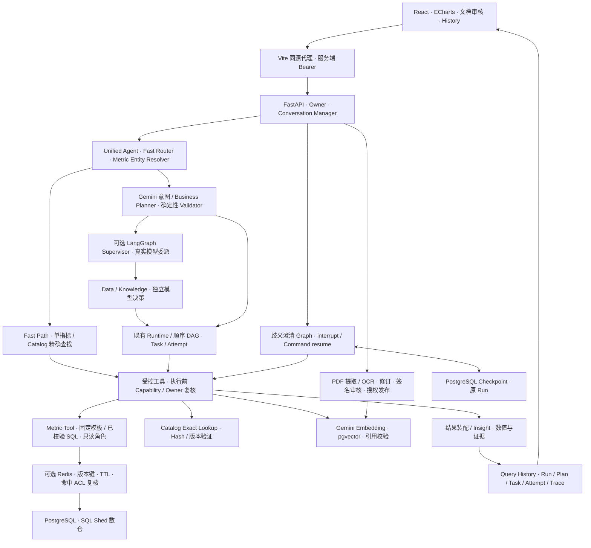

# DataQuery Agent

面向电商经营分析的本地 AI 工作台。用户可以用中文查询正式指标、进行跨期比较、核对计算口径，并结合经过审核的 PDF 查看真实页码和原文证据。系统以受控 SQL、权限复核和可追溯任务记录支撑业务回答。

SQL Shed 为 CC0 公开合成电商数据，已建设 **7 张 ODS、4 张 DWD、5 张 DIM、6 张 DWS、3 个 ADS 视图**。指标目录包含 **26 项已验证、4 项待验证、8 项不支持**。[数据来源](docs/SQLSHED_INGESTION.md) · [指标目录](metrics/warehouse_catalog_v1.json)

## 能力与技术栈

- **问数与可视化**：正式指标、受支持的多指标比较和排行、澄清及连续追问。订单量支持月度折线图、渠道柱状图，多指标结果保留表格。
- **SQL + PDF**：一个正式指标及时间窗口可联合一个明确 PDF 主题，返回数据库事实、有效文档引用和各任务状态。
- **可选 Multi-Agent**：Gemini Supervisor 委派 Data / Knowledge 角色，角色以独立上下文判断执行或暂缓，复用既有受控工具。
- **持久化 HITL**：指标口径歧义通过真实 LangGraph interrupt 暂停，PostgreSQL Checkpoint 支持服务重启后恢复原 Run。
- **缓存与治理**：Redis 缓存绑定 Owner、结构化参数及版本，命中仍复核权限；History 保留 Run、Plan、Task、Attempt、Capability 与引用关联。

Python 3.12、FastAPI、Gemini、LangGraph、SQLGlot；PostgreSQL 16、pgvector、Redis；React、TypeScript、Ant Design、ECharts、Vite。pypdf 提取 PDF 文本，macOS Apple Vision 识别扫描页，SQLite 暂存本机文档审核记录。

## 当前架构



Fast Path 处理简单正式指标和确定性的 Catalog 查询。复杂请求先形成候选计划，Validator 校验正式口径、维度及时间条件。启用 Supervisor 后，模型可在授权角色中做委派与专业决策；工具分发、DAG 状态、权限和结果验证继续由确定性程序执行。LangGraph 管理外层协调状态，既有 Runtime 管理 Task/Attempt。Insight 汇总已验证事实与引文，PDF 规则无法证明实际经营变化的原因。

指标工具使用固定模板，受支持的明细路径另经 SQLGlot 与 Capability 校验。正式定义走 Catalog 精确查找，Query Embedding 调用为零。PDF 在审核和显式授权后生成向量，回答前复核当前文档版本、Owner、Hash 和引文。[架构与运行说明](docs/warehouse/FINAL_README_DEMO_RELEASE.md) · [SQL+PDF 数据流](docs/warehouse/SQL_DOCUMENT_HYBRID_V1.md)

## 本地安装与启停

准备 Python 3.12、Node 22.12+、Docker Compose。扫描 PDF 需要 macOS 和 Xcode Command Line Tools。数据库运行于 Docker，API 和前端运行于宿主机。

```sh
python3.12 -m venv .venv
.venv/bin/python -m pip install -r requirements.txt -r requirements-pdf.txt
npm --prefix frontend ci
cp -n .env.example .env
chmod 600 .env
```

用本地编辑器填写数据库和 Gemini 配置，再启动 pgvector 数据库。

```sh
docker compose -f compose.yaml -f compose.rag.yaml up -d --wait db
```

首次还需下载数据、构建数仓、创建只读及元数据角色、生成本地 Bearer 与 PDF 审核密钥。按[完整首次安装步骤](docs/warehouse/LOCAL_RELEASE.md)完成初始化。Catalog 索引和 PDF 发布涉及外部 Embedding，执行前确认资料授权。

```sh
.venv/bin/python scripts/local_workspace.py --check
.venv/bin/python scripts/local_workspace.py
```

打开 [127.0.0.1:5173](http://127.0.0.1:5173/) 或 [localhost:5173](http://localhost:5173/)。Ctrl-C 停止 API 和 Vite；数据库可用同一 Compose 配置执行 `stop db`，保留数据卷。

**可选功能**：Supervisor 安装 `requirements-langgraph.txt` 并设置 `DATAQUERY_SUPERVISOR=1`。HITL 另执行 `scripts/provision_hitl.py` 并设置 `DATAQUERY_HITL=1`。Redis 安装 `requirements-redis.txt`、启动 `compose.redis.yaml`，设置 `DATAQUERY_REDIS_URL` 和当前 `DATAQUERY_DATA_VERSION`。[完整可选启动命令](docs/warehouse/LOCAL_RELEASE.md#可选编排恢复与缓存)

## 五个演示

| 场景 | 输入与操作 | 核对点 |
| --- | --- | --- |
| 简单指标 | 「2025年1月订单量是多少？」后追问「2月呢？」 | **2312 / 2049**；指标定义、窗口、Trace |
| 多指标趋势与图表 | 查询 2025 年每月订单量和成功支付金额，再单独查询订单量按月拆分 | 多指标表格保留不同事件时间；单指标 **12 个点**。1 月渠道图为 mobile **685**、partner **207**、phone **83**、web **1337** |
| SQL + PDF | 审核发布授权样例后问「2025年1月订单量是多少，并引用PDF扫描页的 Order count 原文。」 | SQL **2312**，PDF 第 **2** 页 `Order count: 48`；缺失证据时 partial |
| Supervisor 委派 | 启用 Supervisor，提交带明确页码和原文范围的 SQL+PDF 请求 | 真实 supervisor、data、knowledge_agent 模型事件及原 DAG 工具记录 |
| HITL 跨重启 | 启用两项编排开关，问「2025年1月销售额」，暂停后重启服务并选择口径 | 原 Run 恢复，折扣后商品销售金额 **231920.18**；暂停前工具 0 次，恢复后 1 次 |

[五组演示脚本与中文架构讲解](docs/warehouse/FINAL_README_DEMO_RELEASE.md) · [PDF 导入及清理细节](docs/warehouse/RELEASE_DEMOS.md)

## 实测证据与复现范围

| 实测 | 结果与条件 |
| --- | --- |
| Router 配对 | 同一组 58 条 Development/Validation，工具路由 **33/43 → 38/43**，E2E **46/58 → 51/58**；已用于诊断。[报告](docs/warehouse/ROUTING_ABLATION_V2.md) |
| 真实 Gemini 专业委派 | 完整结构化组 **3/4**；明确联合题 PDF 页码后复测，按题末次为 **4/4**。包含题目收紧，13 次生成、3813 Token。[报告](docs/warehouse/LANGGRAPH_MULTI_AGENT_V1.md) |
| Redis 聚合缓存 | **并发 5，每种模式三轮合计 360 请求**，P95 **140.34 → 118.08 ms**，完成 QPS **43.71 → 52.79**，指标 SQL **2481 → 0**，保留 **360 次 ACL**。[报告](docs/warehouse/REDIS_PERFORMANCE_V2.md) |
| 历史综合验收 | 发布阶段 **23/23**，适用 ODS **10/10**、Catalog **4/4**、PDF **3/3**；版本与模型条件见[原报告](docs/warehouse/RELEASE_ACCEPTANCE_V1.md)。 |

Redis 数据来自 Apple M4、16 GB、本机 PostgreSQL 16.15 / Redis 7.4.7 的真实 HTTP 压测，使用固定意图隔离模型成本。它测量已验证查询的缓存收益。简单查询同档 P95 为 111.54 → 116.67 ms。真实 Gemini 评测与这些 HTTP QPS 独立统计。本轮启动及回归验证记录在[整理报告](docs/warehouse/FINAL_README_DEMO_RELEASE.md)。

## 安全与已知限制

API 仅限环回本地单人环境，Vite 校验 Host、Origin 与路由白名单，Bearer 留在服务端。每次工具执行保留 Owner、Capability、只读 SQL、文档审核和引用校验。Redis 数据版本由运维显式切换。HITL 支持约定的指标澄清，恢复预占后崩溃需要人工排查。跨期维度贡献、经营因果归因、完整多指标图表、公网多用户部署仍待后续工作。Planner v3 未合并候选排除在此功能清单之外。

OCR 为机器识别，需人工审核；完整流程依赖 macOS。文档列表和 Document ID 定向检索尚缺，刷新后凭已保存的导入 ID 重开；首次上传回执丢失需要人工核实。[文档与安全验收](docs/warehouse/RELEASE_ACCEPTANCE_V1.md)

## CI 与交付验证

[](https://github.com/Boxer-M/dataquery-agent/actions/workflows/ci.yml)

PR 检查包括 Python 3.12 依赖与 pytest、Agent 路由与安全回归、前端测试及构建，以及隔离 Docker Compose 中的 PostgreSQL/Redis 集成与真实 HTTP 冒烟。默认检查不注入 Gemini 密钥，并通过测试钩子禁止创建外部模型客户端。Linux 自动检查跳过 Apple Vision OCR，现有 macOS 验收单独保留。

```sh
.venv/bin/python -m pip install -r requirements-ci.txt
CI_NO_EXTERNAL_MODELS=1 .venv/bin/python -m pytest
npm --prefix frontend test
npm --prefix frontend run build
```

手动 Gemini Golden 评测仅对 main 开放，需明确授权及独立环境密钥，报告保存为短期 Artifact，随机模型得分用于观察回归。[CI 范围、临时环境命令与验证结果](docs/warehouse/CI_CD_ENGINEERING_V1.md)。当前交付为镜像构建和临时环境验证，公开部署需要另行设计。

## 容器构建与发布验证

PR 执行前后端生产镜像构建与隔离部署冒烟。合并 main 后，原 CI 全部成功才允许推送 GHCR；发布任务拉取新镜像的 digest，重新启动临时 PostgreSQL/Redis、FastAPI 和前端生产静态服务，验证通过后保存稳定版本清单与上一版本引用。

镜像使用完整 SHA 加运行号 Tag，部署及手动回退使用不可变 digest 对。运行配置在容器启动时注入，Bearer 留在前端服务端。临时验证默认 0 次 Gemini 调用，不发布宿主端口，保持现有环回安全边界。[CD 构建、配置、版本清单、验证状态与手动回退](docs/warehouse/CD_ENGINEERING_V1.md)

## Skill 注册与经营分析接入（阶段 A / B / C1 / C2.1）

`skills/registry.json` 是受代码审查保护的可信清单。`SkillRegistry` 只读取文本，不执行代码。阶段 B 在 Unified Agent 的适用经营分析路径中，按需把 `business-metric-analysis` 指令加入同一次 Planner 调用；`xlsx` 已固定上游 Commit并完成受限文本审核，可按需加载，工具范围为空；未接入生成或下载。Skill 只能提供业务指导，计划与执行仍由原 Validator、Capability 和受控工具校验。

```python
from dataquery_agent.skill_registry import SkillRegistry

registry = SkillRegistry()
summaries = registry.list_skill_summaries()  # 仅名称、描述、版本，不读取正文
candidates = registry.select_candidates("生成Excel经营报告")  # xlsx，available=True 仅表示可加载文本
instructions = registry.load_skill_instructions("business-metric-analysis")
reference = registry.load_skill_resource("business-metric-analysis", "contracts")
```

指令与资源每次读取都校验 SHA-256，拒绝未知、未审核、禁用及篡改内容。路径限定仓库 `skills/`，逐级拒绝符号链接，单文件上限 64 KiB。Hash 用于核对受信清单的一致性，不能替代对清单本身的 Git 审查。工具范围仅为声明，不构成授权；构造器的 repo_root 仅供可信应用配置及离线测试使用。

候选选择使用保守的确定性规则，不确定、否定和简单指标问题保持原有路径。仅匹配且审核通过的经营分析 Skill 按需进入 planning 上下文，加载失败在模型和工具调用前终止。Trace 与 History 保留版本、Hash、加载/注入状态和原 planning 调用用量；没有独立测量依据的额外 Token 不估算。现有聊天 Skill 路径不生成或下载 Excel。[阶段 B 链路与验收](docs/warehouse/SKILL_BUSINESS_INTEGRATION_V1.md)。

离线验收：`CI_NO_EXTERNAL_MODELS=1 .venv/bin/python -m pytest tests/test_skill_registry.py tests/test_skill_business.py -q`。PostgreSQL 测试需显式设置 `KNOWLEDGE_POSTGRES_TESTS=1`，使用固定提案，仍禁止 Gemini。

C1 的 XLSX 适配保留原始许可证、来源和指令存档，只允许加载适配正文及三个审核资源。未引入上游脚本或运行依赖，不向模型自动注入 XLSX 指令。[锁版与审核记录](docs/warehouse/XLSX_SKILL_REVIEW_C1.md)。

C2.1 提供独立 Python 入口 `generate_metric_xlsx(result, metrics) -> bytes`，将已校验、单窗口无分组的经营汇总写入两列工作簿，并自动回读检查精度；不接入聊天、Artifact或下载。新增锁版依赖仅为 openpyxl 3.1.5 与 et_xmlfile 2.0.0。[输入契约与真实 PostgreSQL 回读验收](docs/warehouse/XLSX_REPORT_GENERATION_V1.md)。
