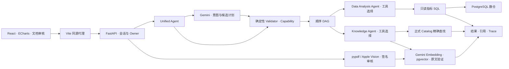

# DataQuery Agent

DataQuery Agent 是一个面向电商经营分析的本地工作台。使用者可以用中文查询订单、商品和渠道指标，按月或按渠道查看图表，追问上一轮结果，并核对计算口径和来源。对于“查 1 月订单量，并引用 PDF 规则”的问题，系统分别返回数据库数值和文档原文，记录各项任务的执行状态。

SQL Shed 提供 CC0 公开合成电商数据，覆盖 7 张 ODS 表、4 张 DWD 事实表、5 张维度表、6 张 DWS 汇总表和 3 个 ADS 视图。目录收录 38 项指标，26 项已通过数据验证。[数据来源与入库验收](docs/SQLSHED_INGESTION.md)

## 核心功能

- **自然语言问数**。标准指标、多指标比较与筛选、歧义澄清、会话追问、月度与渠道图表。
- **可追溯执行**。指标服务使用受控 SQL。部分明细需求通过固定模板或经 SQLGlot 和 Capability 校验的 SQL 执行。History 可查看计划、任务、执行批次、工具和来源。
- **审核式 PDF 知识库**。本地上传、逐页检查原生提取和 OCR、修订、签名审核及授权发布。问答返回有效版本的真实页码和原文。
- **SQL 与 PDF 联合分析**。一个正式指标及统计窗口可结合一个明确 PDF 主题。DAG 保留可验证的部分结果和各节点失败原因。

## 技术与架构

React、TypeScript、Ant Design 和 ECharts 提供工作台，Vite 同源代理将请求送到 Python 3.12 的 FastAPI。PostgreSQL 16 保存数仓、会话和 pgvector 知识索引，SQLite 保存本机 PDF 暂存记录。pypdf 提取原生文本，macOS Apple Vision 识别扫描页。



真实 Gemini 调用负责自然语言意图、候选计划、知识摘录及向量计算。专业 Agent 的工具选择与 DAG 调度由确定性代码执行。Capability 验证通过后，数据侧以只读账号取数。知识侧引用审核文档的有效页码及原文，正式指标定义走 Catalog 精确查找。联合请求的汇总节点依赖两个独立任务，数据库事实和文档摘录分别展示。[联合分析数据流](docs/warehouse/SQL_DOCUMENT_HYBRID_V1.md)

## 本地运行

准备 Python 3.12、Node 22.12+ 和 Docker Compose。完整扫描 PDF 演示需要 macOS、Apple Vision 与 Xcode Command Line Tools。浏览器验收需要 Chrome。首次初始化后运行：

```sh
.venv/bin/python scripts/local_workspace.py --check
.venv/bin/python scripts/local_workspace.py
```

打开 [本地工作台](http://127.0.0.1:5173/)。Ctrl-C 停止工作台和 API，数据库可独立停止。[首次安装、启动、停止及故障定位](docs/warehouse/LOCAL_RELEASE.md)

## 三组演示

| 场景 | 操作 | 已核对的结果 |
| --- | --- | --- |
| 指标、追问与图表 | 查 2025 年 1 月订单量，追问 2 月；查 2025 全年后输入「按月拆分」 | 1 月 **2312**、2 月 **2049**，12 个 ECharts 月度数据点 |
| 审核式 PDF 问答 | 上传样例，修订并审核发布第 2 页，查询修订行 | 第 2 页、审核文本行号、逐字引文和原件 SHA-256 |
| SQL 与 PDF | 查 2025 年 1 月订单量，并引用 PDF 扫描页的 Order count 原文 | SQL **2312**，PDF 第 2 页 `Order count: 48`；History 可查看指标、PDF、汇总节点 |

[完整演示脚本、来源及复现步骤](docs/warehouse/RELEASE_DEMOS.md)

## 验收、安全与限制

发布准备复跑现有 **23/23 个综合场景**并通过 Python 与前端回归。指标结果与独立 ODS 对账，PDF 引用与当前版本、Owner 权限和原件 Hash 核对。报告分别记录真实 Gemini 调用与受控故障注入。[发布验收](docs/warehouse/RELEASE_ACCEPTANCE_V1.md) · [既有 23 场景基线](reports/warehouse/sql_document_hybrid_v1.json)

服务绑定环回地址。Vite 保管本地 Bearer 并校验 Host、Origin 及精确路由。发布检查 Owner、版本和审核签名，明确授权后才发送审核文本生成向量。原始 PDF 留在本机。项目适合单人本地演示，合成数据缺少实际利润、退款到账等口径。完整扫描 OCR 依赖 macOS。已知 Document ID 可在刷新后重开。首次上传回执丢失且没有 ID 时，需人工确认是否已创建。知识检索以标题作为线索，当前范围没有 Document ID 定向检索或完整文档列表。[安全核查与版本行为](docs/warehouse/RELEASE_ACCEPTANCE_V1.md)
