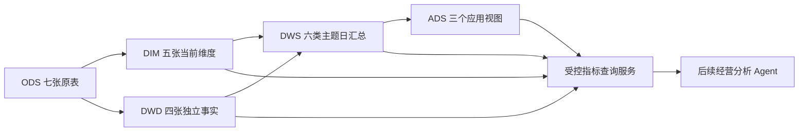

# 整体架构与模型取舍

## 目标与业务时钟

先交付独立于 Agent、可用 SQL 和测试单独验收的电商数仓，再接统一查询服务。消费端输入 metric_id、明确的时间窗/维度/过滤和观察截止，输出可追溯结果。主要风险是事实扇出、时间混用、观察期偏差、把快照属性伪装为历史，以及把源记录金额解释成财务收入。

订单以 ordered_at（现有明细别名 order_purchase_time）计时；支付尝试以 paid_at 计时；退货以 returned_at 计时。时间均为源无时区值，采用 [start,end)，不默认转换为 UTC 或北京时间。as_of 是排他事件观察截止，不是源系统当时入库可知时间。技术构建时间另用 TIMESTAMPTZ UTC，不混入业务时间。

三个独立金额始终分列：商品折扣后金额、captured 支付金额、源退货记录金额。当前没有可验证的“确认收入/财务净收入/已到账退款额”。取消单和业务异常默认保留，状态过滤来自每个指标契约，不在 DWD 偷删。

ODS 仍独立保留，不作为普通 Agent 查询路由。箭头表示逻辑依赖，不授权本轮执行任何建表。

## 物理对象选择

| 层 | 对象 | 业务用途与取舍 |
|---|---|---|
| ODS | 现有 7 表 | 原粒度、原字段、源快照溯源，不改写 |
| DWD | order_fact、order_item_fact、payment_attempt_fact、return_record_fact | 四种事件粒度各自唯一，不摊平成多事实宽表 |
| DIM | customer、product、category、date、channel | 客群、商品、品类、不同角色日期、渠道共享语义；客户/商品仅当前快照 |
| DWS | order_day、product_sales_day、payment_day、return_day、item_return_cohort_day、customer_order_day | 核心主题可复用汇总；保留比率分子分母，客户身份去重不在日级丢失 |
| ADS | business_overview_day、payment_anomaly_order、product_return_cohort | 优先普通视图，封装消费结构；不为层级齐全额外复制一套事实 |

第一版不建设持久月表：可加指标从日表汇总；月度客户去重和复购重新按 customer_id 聚合；明细退货率固定同一 as_of 后累加分子分母；产品/品类销售金额从同一 product_sales_day 通过唯一商品→品类关联上卷。不存在泛化的“所有日指标直接 SUM 成月指标”。

不单建客户生命周期价值表、历史成本表、已完成退款表、自然人归并表；源不足时标记 unsupported。支付失败原因保留在事实，最初用受控动态查询，不提前建大量低复用细分汇总。

## 事实与维度边界

维度只用真实源业务主键。客户 email 不唯一，不当主键，不据此合并账户；查询服务不公开姓名/email。商品 unit_price/unit_cost 为当前属性，不用于历史成交或利润推断；历史金额来自明细。品类父子关联是多对一，当前根节点为 NULL；必须检查无循环及父类存在，不因根节点为空删品类。

事实没有需要的外键时不凭空加：payments 无 product_id，按商品分析支付金额无法可靠分摊，返回 unsupported；returns 通过唯一明细派生 order_id/product_id，再唯一关联订单。现有明细表保持 14 列不变，customer/channel 用唯一 order_fact 关联获取，不为方便汇总强制修改该表。

NULL 可选维度保留未知组。事实必填键缺失/孤儿先阻断验收，不用“未知客户”掩盖源完整性问题。根品类和未入会等合法 NULL 不等于结构错误。

## 快照、历史与发布

首批沿用现有源快照，同时验证既有 order_item_fact；其他新表在同一事务创建与验收。一次批量交付 DWD+DIM，不分单表 PR。DWS已独立验收，ADS为后续独立PR；两者必须绑定同一source_snapshot_id、模型与指标版本，不允许混合不同批次维度和事实。

源没有 updated_at/CDC/delete 标记，第一版**不承诺按事件时间做可靠增量**。相同快照重跑只校验/复用；新快照全量构建新版本，不覆盖当前表。物理版本命名、清单和发布策略见 BUILD_AND_RELEASE.md。当前 order_item_fact 必须原位保留；未来 schema 迁移或视图切换另行评审，不自动 TRUNCATE/DROP/重命名它。

模型、指标与查询服务各自版本化。旧的八项指标定义原文件不动，扩展目录不把尚未实现的汇总标成“现成”。本轮不修改数据库角色或 Agent 实现。
