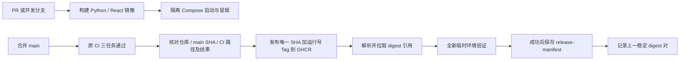

# CD Engineering v1

基于已合并 CI 的 main `7fc9083`，增加生产镜像构建和临时环境交付验证。Agent、SQL 执行器、数据库权限和指标口径沿用已有代码。容器运行于 Linux，扫描 PDF 的 Apple Vision OCR 仍需 macOS，不在本次容器验收范围。

## 构建与发布顺序



[cd-build.yml](../../.github/workflows/cd-build.yml)在 PR、当前 CD 开发分支推送及手动操作时构建并加载镜像，不登录 GHCR，不发布镜像。原 CI 继续负责完整测试，CD 负责真实生产构建和部署冒烟。两个检查应在合并前通过。

[cd-release.yml](../../.github/workflows/cd-release.yml)仅由 main 的 CI 完成事件触发。发布门禁再次检查 CI 的 completed/success、push、main、同仓库、当前 main SHA、CI 文件路径，并确认 Python、frontend、integration-smoke 三任务均成功。发布并发串行化，完成时再次检查 main 没有前移，避免旧提交被标记为新稳定版本。privileged workflow_run 的信任边界参考 [GitHub 事件文档](https://docs.github.com/en/actions/reference/workflows-and-actions/events-that-trigger-workflows#workflow_run)。

权限限定为 contents:read、actions:read 与 packages:write，分别用于源码、CI/历史清单、GHCR 推拉。使用自动 GITHUB_TOKEN，未使用本地 PAT、Gemini Key 或生产数据库密码。正式发布仅在 main 合并后执行。[GitHub GHCR 发布方式](https://docs.github.com/en/actions/tutorials/publish-packages/publish-docker-images)

## 镜像与可复现输入

- 后端 [Dockerfile](../../Dockerfile)的 runtime target 固定 Python 基础镜像 digest，安装 [requirements-container.lock](../../requirements-container.lock)中的完整运行依赖。这份锁来自已验收镜像的系统包集，不包含 user-site pytest。单元测试核对原有四份运行依赖的显式版本均在锁中。
- 前端 [Dockerfile](../../frontend/Dockerfile)固定 Node 24 digest，使用 npm ci 和 package-lock，生成 React 生产静态文件。运行阶段仅含 dist、Node 标准库静态服务和原有受控 API 代理，不带 node_modules 或 Vite dev server。
- OCI revision/source 标签记录来源 SHA 与仓库，Buildx GHA cache 分别缓存后端与前端。输入锁定支持重复构建，未宣称跨平台或不同构建时间下字节级 digest 相同。发布首版只构建 GitHub Ubuntu 的 linux/amd64，Mac 本地验证可能为 arm64。
- GHCR 路径为 `ghcr.io/boxer-m/dataquery-agent-backend` 与 `ghcr.io/boxer-m/dataquery-agent-frontend`。Tag 为 `sha-<完整SHA>-run-<run_id>-<attempt>`，每次尝试独立，不覆盖旧发布。正式引用为 `ghcr.io/...@sha256:<digest>`。
- .dockerignore 排除凭据、个人文档、原始数据及本地构建文件，前端也排除 .env、.npmrc。构建参数只含公开版本信息。

## 临时部署与配置

[compose.cd.yaml](../../compose.cd.yaml)叠加现有四份 CI Compose。PostgreSQL、Redis、后端、前端和检查容器共享此专属数据库的网络命名空间，不映射宿主端口，保留既有 127.0.0.1 与 Host/Origin 限制。它是隔离部署验证环境，现有 Mac 浏览器工作台仍按本地手册运行；本轮没有新增公网入口。

初始化容器复用已有 SQL Shed 下载、审计、建模、角色、Checkpoint 和正式 Catalog 索引准备。Catalog 使用固定向量仅支持精确定位，未把它计作真实向量检索评测。服务启动后从运行时卷读取配置。后端拿专用查询/元数据角色，`.env` 只导出模型配置，不导出初始化 PostgreSQL 管理员；前端卷只有 Bearer 文件。所有凭据均在构建后生成，权限 0600。

```sh
# 在仓库根目录构建本地候选镜像，使用同一个公开版本标签
export RELEASE_COMMIT=$(git rev-parse HEAD)
export BACKEND_IMAGE=dataquery-backend:sha-$RELEASE_COMMIT
export FRONTEND_IMAGE=dataquery-frontend:sha-$RELEASE_COMMIT
docker build --target runtime --label org.opencontainers.image.revision=$RELEASE_COMMIT -t "$BACKEND_IMAGE" .
docker build --label org.opencontainers.image.revision=$RELEASE_COMMIT -t "$FRONTEND_IMAGE" frontend
export COMPOSE_PROJECT_NAME=dataquery-cd-local-demo
bash scripts/cd/validate.sh
```

[validate.sh](../../scripts/cd/validate.sh)拒绝非 dataquery-cd-* 项目名和既有测试卷，先核对镜像 OCI SHA，再启动依赖、初始化、启动两个服务并等待健康。前端从生产静态资源服务真实 HTML/JS，代理经真实 FastAPI 执行正式 Catalog 定义查询，核对引用及 History/Trace；结构化 Metric Query Service 查询独立核对订单量 2312。全量静态产物扫描确保不含运行时 Bearer。默认 Gemini Key 为空，验证模型尝试及 Query Embedding 均为 0。

退出 trap 清理当前专属容器和卷。现有数据库、容器和宿主配置不在清理范围。结果在 artifacts/cd-smoke.json，包含来源 SHA 和镜像引用，发布时将它与当前候选绑定，拒绝旧冒烟报告。临时数据来自真实 SQL Shed 公开合成数据，原始 Parquet 不进入镜像或 Git。

## 稳定版本与回退

稳定版本定义为通过临时部署验证的不可变镜像对及已完整上传的稳定清单，不使用两个可独立漂移的 mutable stable/latest 标签。最终 release-manifest-<attempt> Artifact 的 release.json 包含来源提交、CI run、两项 digest、发布 run 和上一稳定清单。仅在验证及所有前置步骤成功后上传，保留 90 天。失败时可保留已通过 CI 的候选镜像，稳定清单保持上一成功版本。

清单按 attempt 独立保存，通过部署验证后才上传。之后的失败重跑不会隐藏先前清单，读取时按 Artifact 创建时间选择最近一份；查询范围为最近 100 次发布运行。首次没有上一稳定版本。后续自动读取上一份完整的已验证清单并验证其仓库和 digest；清单过期或无效会阻止稳定发布，需恢复已下载清单。GitHub Artifact 签名下载地址不会接收转发的 GitHub Authorization。镜像 digest 保留在 GHCR，禁止手工删除仍用于回退的版本，清单也应在本地留存。

从已验证发布下载并解压 release-manifest-<attempt>，先登录所需 GHCR 读取权限，然后演练上一版：

```sh
docker login ghcr.io
python3 scripts/cd/release.py rollback --manifest release.json --project dataquery-cd-rollback-demo
```

命令校验清单、拉取上一对 digest 并在新临时环境验证它们。首次发布会明确拒绝“上一版”操作。实际部署如需回退，操作者应明确选定该对镜像和既有运行配置，再人工切换服务；生产配置、数据迁移兼容和自动生产回滚不在本轮范围。

## 验证状态

发布门禁负例覆盖 CI 失败、PR、非 main、外部仓库、错误 CI 路径、过期 main SHA、未验证清单及可变镜像引用。前端真实 HTTP 测试覆盖生产资产、私有文件、目录穿越、伪造 Host/Origin 和非法 API 路由，原有代理测试继续执行。

GHCR 正式推送、候选 digest 拉取及上一稳定版本读取要求本分支经 PR 合并且 main CI 成功。本轮合并前不提前发布，也不把官方基础镜像拉取当作候选镜像 GHCR 拉取验收。相关步骤已实现，真实 GHCR 记录待合并后首次发布生成。每次发布的 Artifact 保留验证与回退依据。
