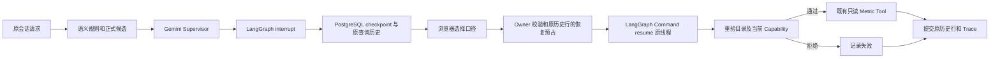

# Human-in-the-loop MVP v1

支持正式指标的单一口径歧义。例题「2025年1月销售额」先由已有语义规则发现歧义并生成正式候选，再由 Gemini Supervisor 决定请求人工确认。可继续的答案只能是候选中的指标 ID。



初次申请的 Run UUID 直接用作 LangGraph thread ID。checkpoint 保存候选、已冻结的时间和原请求条件，以及目录指纹。数据库连接和模型调用器在运行时注入。恢复使用原 Graph 的 interrupt 节点，LangGraph 从该节点开头重入。节点在 `interrupt()` 之前没有工具副作用。启动 SQL 前，恢复入口对原历史行做事务预占，随后重新核验 Owner、目录、指标条件和执行期 Capability。此阶段读取当前数据，通过现有只读执行器校验可用角色和来源。暂停前的 SQL 调用为零。已执行的联合计划仍使用现有 Catalog 定向恢复。

`GET /api/queries/{run_id}` 返回原历史、澄清状态及候选。`POST /api/queries/{run_id}/resume` 接收 `{"metric_id":"item_net_sales_amount"}`。提交成功后返回同一 Run 和 Trace，历史记录包含暂停、人工选择、恢复结果及工具 Trace。跨 Owner 返回 404，过期或重复提交返回 409。恢复开始后进程崩溃时，已预占的记录保持不可重试，防止 SQL 可能已执行后再次执行。异常排查以原 Trace 为准。PDF 批准和拒绝继续通过原文档审核流程处理。

## 启用与演示

```sh
.venv/bin/python -m pip install -r requirements-langgraph.txt
PYTHONPATH=src .venv/bin/python scripts/provision_hitl.py
DATAQUERY_SUPERVISOR=1 DATAQUERY_HITL=1 .venv/bin/python scripts/local_workspace.py
```

1. 打开 [本地工作台](http://127.0.0.1:5173)，输入「2025年1月销售额」。
2. 等待正式候选出现。关闭并重新启动工作台服务，然后刷新同一浏览器标签页。
3. 选择「折扣后商品销售金额」，页面显示原运行完成和查询结果。
4. 点击「查看查询历史」，核对人工澄清事件和 SQL 工具步骤。

浏览器同一标签页保存待恢复 Run ID，刷新后由已授权的历史接口读取待办。验收使用 Chrome、隔离的环回测试服务、真实 Gemini 和本地 PostgreSQL。正式工作台代理的 Resume 路由白名单另由自动测试验证。

```sh
HITL_POSTGRES_TESTS=1 PYTHONPATH=src:tests .venv/bin/python -m unittest -v test_hitl
HITL_POSTGRES_TESTS=1 HITL_LIVE_GEMINI=1 PYTHONPATH=src:tests \
  .venv/bin/python -m unittest -v test_hitl
```

[浏览器 Pause → Resume Trace](../../reports/benchmark/hitl_mvp_v1_browser.json)记录真实 Gemini 澄清、后端进程重启及浏览器刷新。该次运行以原 Run 返回 `231920.18`，暂停前调用零次工具，恢复后调用一次。

Python 全量回归执行 228 项，226 项通过，两个独立可选真实模型测试跳过。PostgreSQL 专项覆盖重复、非法候选、跨 Owner、Owner 权限变化、过期与 Capability 拒绝。Capability 撤权通过故障注入验证。前端五项测试、类型检查和生产构建通过。
