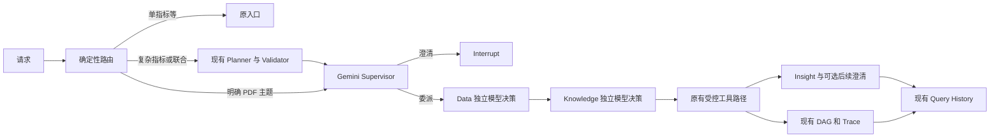

# LangGraph Multi-Agent MVP v1

确定性入口先识别请求边界。明确问数、正式 Catalog 及原有恢复命令继续使用原入口。对于已启用编排的复杂指标、明确 PDF 主题及 SQL + PDF，Supervisor 使用 Gemini 在允许的角色里选择委派或澄清。Data 节点接收原文与已验证指标计划摘要，Knowledge 节点只接收文档主题及审核范围。两者分别用同一个 Gemini 适配器独立决定是否执行，输出限定为批准或暂缓。



角色可独立暂缓。联合请求仍由同一个 DAG 执行，成功 SQL 和有效 PDF 摘录分别保留。Insight 对成功的联合分析明确两种证据各自支持的结论。部分成功时可以发起一次模型判断是否需要补充范围，现有结果随原响应返回。Graph State 保存委派、批准和澄清标志。Task、Attempt、依赖、租约和幂等由现有运行时处理。初始澄清进入 Interrupt 节点，部分成功可设置相同标志。当前无持久化恢复协议。

现有 `AgentRuntime` 为整次请求最多记录六次生成尝试。Graph 最多有两次协调判断，首次委派和部分成功后的调查判断各一次。模型只能在已验证角色范围内选择。原 Capability 执行前复核、只读 SQL、Owner、PDF 发布版本及引用校验继续生效。Trace 与 Query History 使用原 Run ID，新增有界决策事件和 `interrupt_required`。LangGraph 调用关闭 LangSmith 遥测。

## 启用与验证

Python 3.12 使用独立的可选依赖清单。保留原启动方式，在服务进程设置开关即可启用。

```sh
.venv/bin/python -m pip install -r requirements-langgraph.txt
DATAQUERY_SUPERVISOR=1 .venv/bin/python scripts/local_workspace.py
PYTHONPATH=src:tests .venv/bin/python -m unittest test_supervisor_graph.SupervisorTests
SUPERVISOR_LIVE_TESTS=1 SUPERVISOR_LIVE_REPORT=/tmp/dataquery-supervisor.json \
  PYTHONPATH=src:tests .venv/bin/python -m unittest test_supervisor_graph.SupervisorLiveTests
```

真实评测使用合成 PDF 样本、Owner 专属临时索引和真实 PostgreSQL。Gemini 执行生成任务，本地固定测试向量隔离 Embedding 模型变量。评测结束撤下临时文档。Graph 呼叫之间不共享数据库结果、私有文档正文或 Owner 凭据，知识回答继续由原有 RAG 提示词接收通过权限核验的片段。

参考 [LangGraph Graph API](https://docs.langchain.com/oss/python/langgraph/graph-api) 与 [LangGraph Python 发行信息](https://pypi.org/project/langgraph/)。

## 实测结果

使用 `gemini-3.5-flash-lite`。完整结构化复测通过 3/4，联合题返回 `partial`，保留 SQL 并记录 PDF 证据部分支持。明确指定 PDF 第 2 页和原文范围后，单独复测联合题通过，返回订单量 2312 和审阅过的扫描页引文。按每个场景最后一次结果汇总为 4/4，6 次工具调用，13 次 Gemini 生成，API 报告 3813 Token。4 个样本的最近秩 P95 为 26.163 秒。该汇总包含一次题目范围收紧，完整批次的 P95 为 51.388 秒。

[逐次运行和失败 Trace](../../reports/benchmark/langgraph_multi_agent_v1.json)保留初次输出格式拒绝、结构化全量复测及联合单题复测，包括外部重试。越权验收另以固定提案复现跨 Owner 的 PDF 查询，确认保留 2312 且引文列表为空。Python 227 项中 225 项通过，两项可选真实模型测试在常规回归中跳过。前端 5 项测试、TypeScript 检查和生产构建通过。
