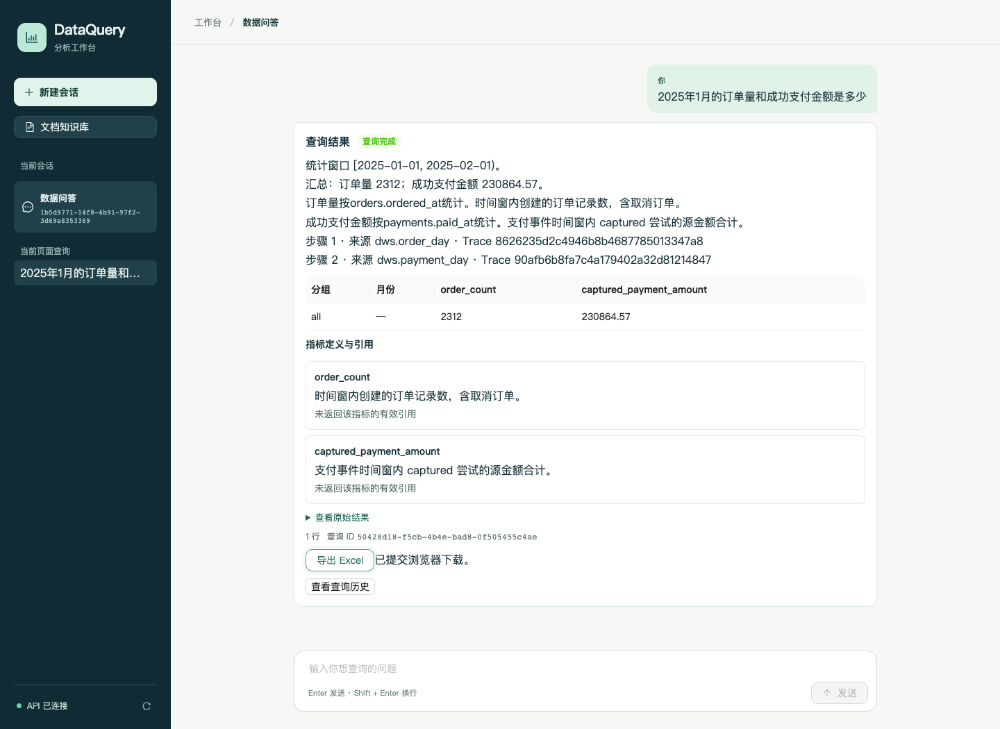
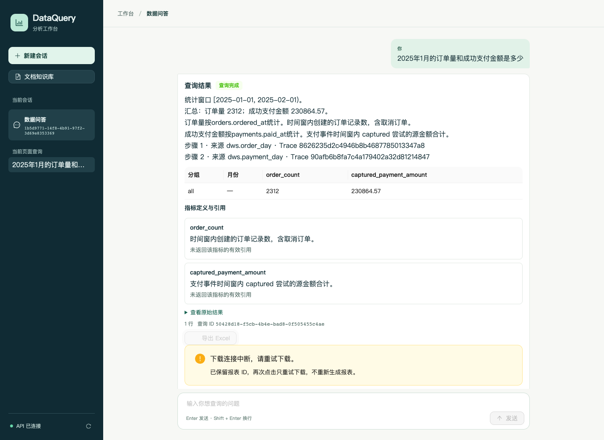

# 前端 XLSX 导出（C2.3）

基线：C2.2 已合并的 main `39baf66`。仅增加查询结果导出入口及必要的同源代理支持，没有新增后端接口或自然语言路由。

## 数据流与交互

`QueryResult` 使用原 `/api/chat` 或历史响应实际返回的 query_id。对completed且有Query ID的结果展示“导出 Excel”，不在前端复制快照、分组或金额精度资格判断。

```text
点击 → POST /api/queries/{query_id}/artifacts/xlsx，JSON为{}
     → 校验服务端Artifact回执与Query ID，保留Artifact ID
     → GET /api/artifacts/{artifact_id}/download
     → 校验MIME、附件文件名、大小及SHA-256
     → Blob下载，文件名取服务端回执
```

`export-excel.tsx` 展示生成/下载进度及错误；`xlsx-export.ts` 是当前结果组件内的轻量会话，缓存回执和进行中的Promise。同步锁与按钮loading防止快速重复点击。下载失败再次点击只复用已有Artifact ID发起GET，成功后再次下载也不新建产物。不在浏览器持久化Token、工作簿或回执。

409提示用户主动重新运行完整指标查询后再导出，不调用sendQuestion或其他查询入口。401/403/404显示报表或源查询不可访问；网络失败恢复按钮并说明已保留ID。不自动重试、不自动重跑查询。完整资格仍由C2.2后端判断，分组、比较、旧历史无快照等仍可能409。

## 认证与代理

复用 `api.ts` 同源fetch及X-DataQuery-Client头。Bearer仍只由Node代理读取本地配置并添加，浏览器请求与构建产物均不包含该Token。

代理只新增两个精确UUID路径及其POST/GET方法，导出要求JSON与同源Origin；仍只转发127.0.0.1:8000，保留Host、Origin、客户端及路由校验。只对授权下载路径的200响应允许XLSX二进制和严格附件文件名，大小上限1 MiB；错误响应继续走JSON，其他响应头不任意透传。不是通用二进制代理。

## 浏览器验收

使用真实Google Chrome（Playwright驱动）、真实PostgreSQL、现有FastAPI和Vite代理。初始规划使用已有固定提案，不属于真实Gemini理解测试。自动审批未授权本轮额外真实Gemini数据外传，相关命令未执行，改用不调用外部模型的验收实例；没有修改生产规划逻辑或Prompt。

输入：“2025年1月的订单量和成功支付金额是多少”。初始查询经原Validator和受控工具返回真实数值；浏览器成功下载并使用openpyxl重新打开：

| 单元格 | 名称 | 实际值 | 类型/格式 |
| --- | --- | --- | --- |
| B2 | 订单量 | 2312 | n / 0 |
| B3 | 成功支付金额 | 230864.57 | n / 0.00 |

工作簿仅一表“经营指标”，下载文件名匹配服务端元数据，下载内容与SQLite保存字节及Hash一致。实际 `query_id → Artifact ID → 下载文件` 关联见 `reports/warehouse/xlsx_export_ui_v1.json`。

初始问数：2次业务指标SQL、1次固定提案回调、真实Gemini 0次。导出及下载阶段：新增业务指标SQL 0次、Gemini 0次，也未新增固定提案回调。计数来自独立验收API对实际指标执行入口和提案回调的观测，缓存和Supervisor关闭，不将固定提案当成真实LLM能力。

浏览器故障注入分别验证409快照不可用、404访问拒绝、首次下载网络中断。前两次注入POST不达后端；随后真实生成请求经快速双击仍只发生1次。下载中断后再次点击使用同一Artifact，GET共尝试2次，只有成功的文件进入浏览器下载。点击导出期间没有新增/api/chat请求。真实Owner隔离由原C2.2后端PostgreSQL测试另行回归，不能将注入404声称为真实多人登录测试。





验收后已退出固定提案实例、恢复普通本地开发API，并再次通过代理下载相同持久化Artifact核对字节一致。实际工作簿留在被忽略的 `artifacts/xlsx-ui/`，不提交Git；本次Artifact使用日常本地SQLite目录，当前Owner可继续访问，受源查询权限及保留策略约束。

## 复现与结果

默认 `npm --prefix frontend test` 不调用模型，包括会话缓存、双击去重、失败重试、回执校验及代理安全回归。构建：`npm --prefix frontend run build`。

浏览器验收需已有本地数仓配置、Chrome、Vite和空闲8000端口；不要覆盖其他正在运行的服务。另开终端运行：

```sh
PYTHONPATH=src:tests .venv/bin/python scripts/evaluate_xlsx_export_ui.py \
  --fixed-proposal --stats /tmp/dataquery-xlsx-ui-stats.json
XLSX_UI_STATS=/tmp/dataquery-xlsx-ui-stats.json node frontend/tests/xlsx-export-browser.mjs
```

验收API只接受该固定规划提案，禁止Embedding，无真实生成模型调用；不是日常问数服务。结束后Ctrl-C并按正常项目方式启动API。原有Vite命令和认证配置不变。

实测前端10项通过，TypeScript及生产构建通过，保留既有大图表chunk警告；Python全量236通过、82项环境门控跳过；真实PostgreSQL Artifact专项6通过。Chrome成功链路及受控失败路径通过。没有新增依赖、修改后端持久化或Agent执行逻辑。

边界：回执只保留当前页面组件内存，刷新或重建组件后可能重新创建Artifact；创建请求结果不明时也不能保证全局幂等，现有后端没有幂等键。当前不提供Artifact列表、删除或跨会话导出管理。
